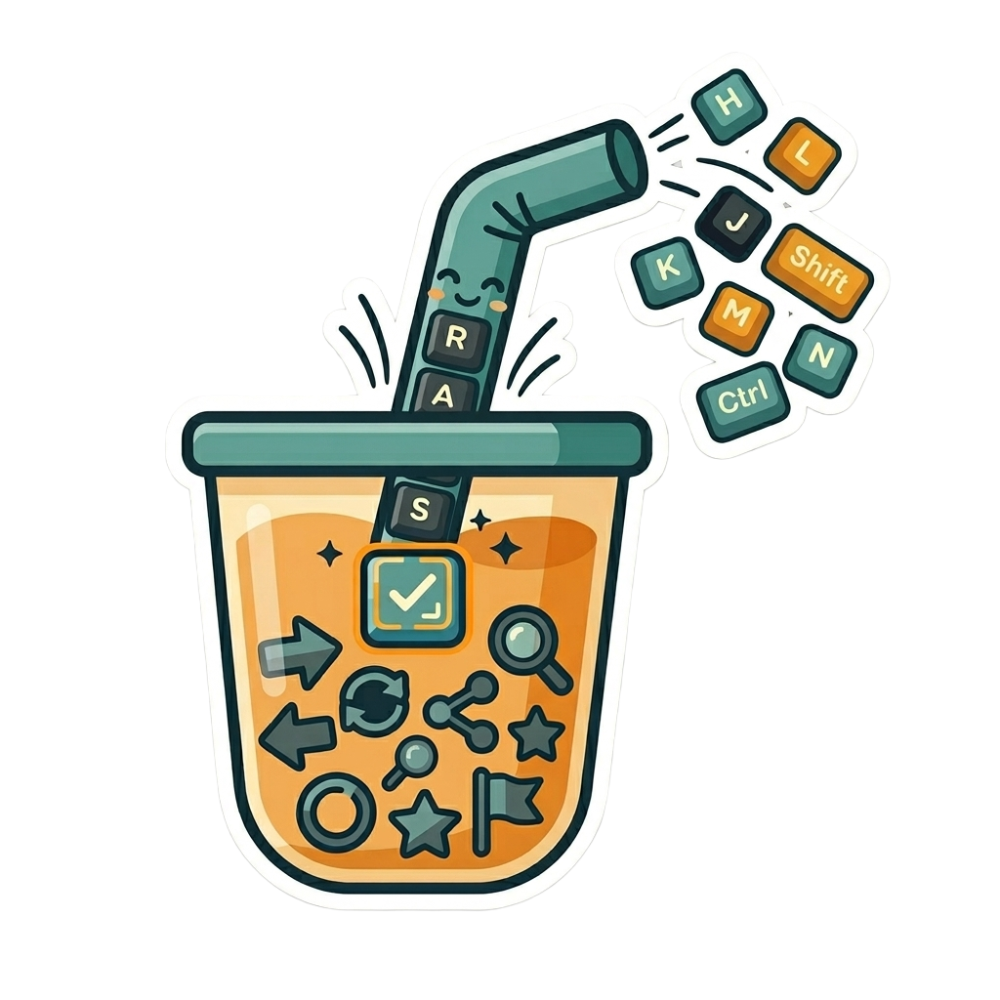

<p align="center">
  
</p>

---

# straw

[](https://pkg.go.dev/github.com/kozikowskik/straw)
[](https://github.com/kozikowskik/straw/actions/workflows/ci.yml)

Give your [Bubble Tea](https://github.com/charmbracelet/bubbletea) app Vim-style multi-key shortcuts: press `g`, then `h` to go home. `straw` tracks the keys while you type and tells your app when a shortcut matches, is waiting for another key, is canceled, or does not match. Your app decides what each shortcut does.

Use [`bubbles/key`](https://github.com/charmbracelet/bubbles/tree/master/key) for shortcuts matched one key press at a time. Use `straw` when a shortcut needs a sequence of presses, such as `gh` or `gd`.

## Installation

Requires Go 1.26.0 or newer, including when using the Bubble Tea v1 adapter. This module declares these versions in `go.mod` (the Bubble Tea versions are dependencies, not tested compatibility minimums):

| Dependency | Declared version |
| --- | --- |
| Go | 1.26.0 |
| Bubble Tea v2 | v2.1.1 |
| Bubble Tea v1 | v1.3.10 |

```sh
go get github.com/kozikowskik/straw
```

Bubble Tea v2 users should import the v2 adapter:

```go
import straw "github.com/kozikowskik/straw/bubbletea/v2"
```

Bubble Tea v1 users should import the v1 adapter:

```go
import straw "github.com/kozikowskik/straw/bubbletea/v1"
```

The root `github.com/kozikowskik/straw` package contains the version-neutral resolver core for advanced use and adapter authors. If you need both packages in one file, import the root package as `strawcore`.

## Quick Start

This complete Bubble Tea v2 program binds `gh` to a go-home action. Save it as `main.go` in a new directory:

```go
package main

import (
	"fmt"
	"os"

	tea "charm.land/bubbletea/v2"
	straw "github.com/kozikowskik/straw/bubbletea/v2"
)

type action int

const goHome action = 1

type model struct {
	resolver *straw.Resolver[action]
	status   string
}

func newModel() (model, error) {
	resolver, err := straw.New([]straw.Binding[action]{
		straw.Bind(goHome, straw.TextSequence("gh")),
	})
	if err != nil {
		return model{}, err
	}
	return model{resolver: resolver, status: "Press g then h to go home. Press q to quit."}, nil
}

func (m model) Init() tea.Cmd {
	return nil
}

func (m model) Update(msg tea.Msg) (tea.Model, tea.Cmd) {
	result, cmd := m.resolver.Update(msg)

	switch {
	case result.Match(goHome):
		m.status = "go home"
	case result.IsPending():
		m.status = "waiting for another key..."
	case result.IsCanceled():
		m.status = "sequence canceled"
	case result.IsUnmatched():
		m.status = "no matching sequence"
	}

	// Only unmatched pass-through keys should reach the host key switch.
	// Pending, matched, canceled, and non-key messages return here. Handle
	// application-owned non-key messages above this guard if needed.
	if !straw.ShouldPassThrough(result) {
		return m, cmd
	}

	if key, ok := msg.(tea.KeyPressMsg); ok && key.String() == "q" {
		return m, tea.Quit
	}

	return m, cmd
}

func (m model) View() tea.View {
	return tea.NewView(fmt.Sprintf("%s\n", m.status))
}

func main() {
	m, err := newModel()
	if err != nil {
		fmt.Fprintln(os.Stderr, err)
		os.Exit(1)
	}
	if _, err := tea.NewProgram(m).Run(); err != nil {
		fmt.Fprintln(os.Stderr, err)
		os.Exit(1)
	}
}
```

Run it with Go 1.26.0 or newer (no repository clone needed):

```sh
go mod init example.com/straw-quickstart
go get github.com/kozikowskik/straw/bubbletea/v2
go run .
```

Press `g` then `h` before the timeout to match. If you press `g` and wait, the unfinished sequence is canceled. A key that fails after `g` is consumed by default, so press `q` when no sequence is pending to quit. The resolver reports results; your app owns the actions and updates its own state.

## Examples

Run the longer examples without cloning the repository:

```sh
go run github.com/kozikowskik/straw/examples/bubbletea-v2@v0.2.0
go run github.com/kozikowskik/straw/examples/bubbletea-v1@v0.2.0
go run github.com/kozikowskik/straw/examples/timeout-cancel@v0.2.0
```

For more bindings and result handling, see the [Bubble Tea v2 example](examples/bubbletea-v2/main.go).

## Features

- Resolve multi-key sequences such as `gh` and `gd`.
- Match modified keys such as `ctrl+c` and `alt+enter`.
- Handle ambiguous prefixes with pending timeouts.
- Inspect pending sequences, available next keys, and bindings waiting for timeout.
- Keep unmatched keys available for normal Bubble Tea key handling.
- Use Bubble Tea v1 or v2 through separate adapter packages.

## Documentation

- [Core concepts](docs/concepts.md): resolver states, sequence matching, timeouts, cancellation, and pass-through behavior.
- [Bindings](docs/bindings.md): text keys, special keys, modified keys, sequences, and binding metadata.
- [Bubble Tea integration](docs/bubble-tea.md): adapter imports, update-loop patterns, nested models, and v1/v2 differences.
- [Troubleshooting](docs/troubleshooting.md): common integration issues and how to diagnose them.

## Status

`straw` is pre-v1 software. The API is intended for early use, but may change before v1 based on real Bubble Tea integrations.

See the [changelog](CHANGELOG.md) for releases and changes.

## Contributing

Contributions are welcome. See [CONTRIBUTING.md](CONTRIBUTING.md) for local setup, tests, benchmarks, and pull request expectations.

Using a coding agent? See [AGENTS.md](AGENTS.md) for repository-specific instructions.

## License

`straw` is available under the MIT License. See [LICENSE](LICENSE) for details.
